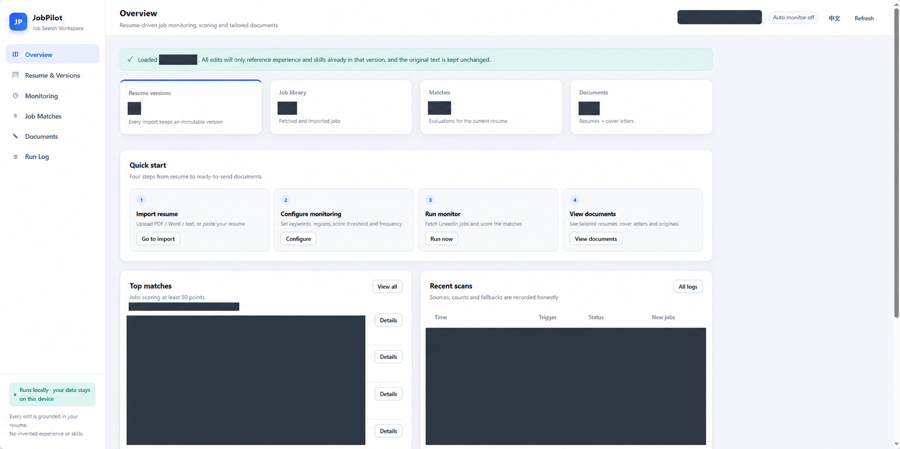
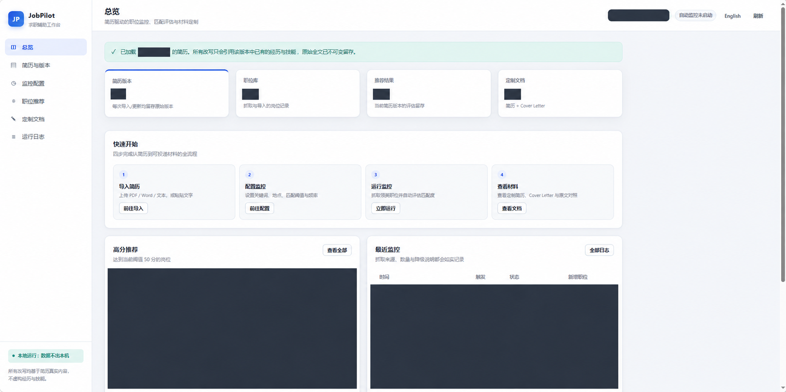
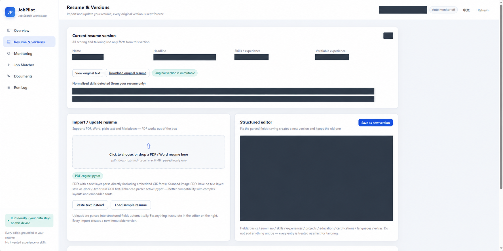
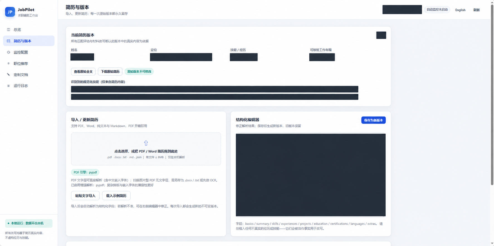
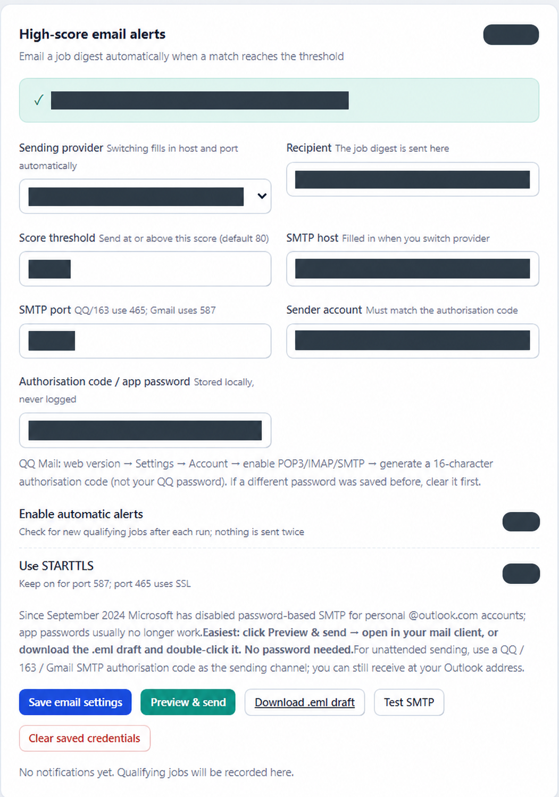
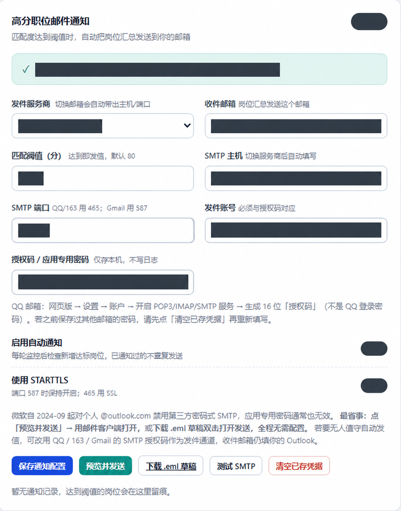
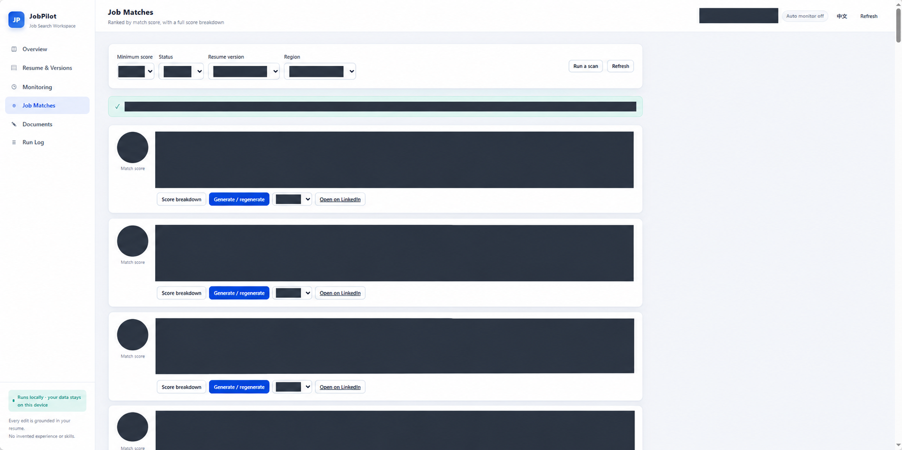
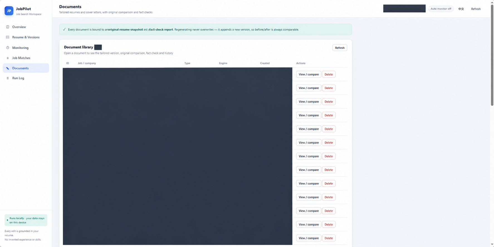

# JobPilot

[简体中文](README.md) · **English**

A local-first job-search workspace: import a resume, collect jobs, inspect explainable matching scores, and generate tailored resumes and cover letters with source snapshots for review.

Python standard-library backend + SQLite + vanilla JavaScript. **Core features require no third-party Python packages or API key.** An OpenAI-compatible endpoint can optionally polish drafts.

> Built for personal, local use. Match scores are rule-based rankings, not hiring probabilities. Review generated content and extracted PDF text. JobPilot does not automatically submit job applications.

## Features

| Feature | Current implementation |
| --- | --- |
| Resumes and versions | PDF, DOCX, TXT, Markdown and JSON import; structured editing; each save appends a version with extracted original text |
| Job sources | Paste job descriptions or import JSON; public LinkedIn job fetching; clearly labelled demo jobs |
| Explainable matching | Skills, experience, role, domain, education and location; matched/missing skills and scoring explanations |
| Tailored documents | Rule-based resumes and cover letters; optional AI polishing; original snapshots and rule-check reports |
| Export | Markdown, TXT and DOCX; regeneration appends document versions |
| Monitoring and notifications | Background interval monitoring, run logs, optional SMTP digests and EML drafts |
| Bilingual interface | Chinese / English toggle with browser-persisted preference; separate document-language setting |

## Screenshots

These eight images have been redacted and approved by their owner for display. Image editing may affect dimensions and some text; the current UI may differ. See the [privacy notes](PRIVACY.md) for data flows.



<details>
<summary>Show the other seven Chinese and English previews</summary>

### Overview (Chinese)



### Resume and versions (English)



### Resume and versions (Chinese)



### Email notifications (English)



### Email notifications (Chinese)



### Job matches (English)



### Documents (English)



</details>

## Quick start

Requires **Python 3.9 or later**. A currently maintained Python version is recommended. Normal use requires no Node.js, database server or frontend build tools.

Download the repository ZIP, extract it, and open a terminal in the project directory containing `app/`.

**Windows**

```powershell
python -m app.server
```

Alternatively, double-click `start.bat`.

**macOS / Linux**

```bash
python3 -m app.server
# Or
bash start.sh
```

Open [http://127.0.0.1:8765/](http://127.0.0.1:8765/). The browser opens automatically by default. Press `Ctrl+C` in the terminal to stop the server.

```bash
python -m app.server --no-browser
python -m app.server --port 9000
```

The `JOBPILOT_PORT` environment variable can also change the port.

### Three-minute demo

1. Open **Resume & versions** and load the sample resume. The person and history are fictional demo data.
2. Use the demo-jobs action in **Monitor settings** to exercise the workflow without LinkedIn access or an AI key.
3. Open **Job recommendations** and inspect scores, skill gaps and explanations.
4. Open **Tailored documents**, compare the draft with its source snapshot and rule-check report, and export DOCX.
5. For real use, import your own resume, verify the structured fields, and update keywords, location and notification settings.

Demo fallback is enabled by default when real fetching returns no jobs. Results show their source. **Disable demo fallback for real searches** to avoid confusing demo results with actual openings. Email delivery requires a valid recipient and SMTP credentials.

## Switching languages

- **README:** use [简体中文](README.md) at the top; the Chinese page links back here. GitHub Markdown uses two linked documents, with no script required.
- **Application:** click `English` / `中文` in the top-right corner, or use `/?lang=en` and `/?lang=zh`.
- **Documents:** choose automatic, Chinese or English separately from the interface language. The rule engine preserves the language of quoted source content; it does not translate the entire original resume.
- Resume text, job descriptions and some backend messages remain in their original language. The interface toggle is not a full-content translator.

## AI, privacy and external connections

The local rule engine is the default. If AI is enabled, **structured resume data (which may contain names and contact details), job descriptions and baseline drafts are sent to the configured API provider**. The API key is sent to that endpoint for authentication. Only configure an endpoint you trust.

| Activity | Data flow |
| --- | --- |
| Resume parsing, rule-based matching/generation, exports | Local processing and storage |
| LinkedIn fetching | Search keywords and locations sent to LinkedIn; traffic also passes through a configured proxy when used |
| Network diagnostics / proxy detection | May probe local proxy ports and external connectivity |
| AI polishing / connection test | Requests sent to the configured model endpoint; polishing includes resume and job content |
| SMTP notification | Authentication to the mail provider; job digest sent to the recipient |
| Optional PDF enhancement installation | pip downloads `pypdf` |

Runtime data is stored in `data/jobpilot.db`. **The database is not encrypted** and may include resumes, contact details, SMTP credentials, API keys, jobs and document history. Masked API responses do not encrypt files on disk.

The server binds only to `127.0.0.1` and checks Host, Origin and JSON requests. There is no account or authorization system. Do not expose it directly to the internet or use it as a multi-user service. These checks do not protect against programs that already have local access.

See [Privacy notes / 隐私说明](PRIVACY.md).

## Matching and document generation

Base weights are skills 40, experience 15, role 15, domain 15, education 5 and location 10, with additional preference adjustments and exclusions. Scores help order results; they do not establish authenticity, availability, visa sponsorship, work authorization or all language requirements.

The rule engine reorders, groups and quotes existing material. AI output is checked against a whitelist of numbers and recognized skills; failed checks trigger rule-based fallback. **The checks do not validate every semantic claim.** Unknown skills, exaggerated responsibilities and incorrect relationships between entities can slip through. Passing a check does not independently verify factual accuracy.

Imports retain extracted text and structured fields, **not the original PDF / DOCX binary**. Keep your own source files. Append-only application behavior is not database-level immutability or tamper resistance.

## PDF and file compatibility

The built-in PDF extractor needs no installation. Optionally install an enhanced parser:

```bash
python -m pip install pypdf
```

Installed enhanced parsers take priority. Failures and obvious control-character or missing-glyph artifacts trigger another parser attempt. This cannot detect every extraction error. Scanned PDFs require separate OCR; columns, tables and unusual fonts may extract incompletely. Try DOCX / TXT or paste text when needed.

## Backups

1. Stop the JobPilot server.
2. Copy the entire `data/` directory and protect the backup as personal data containing potential secrets.
3. Stop the server before restoring a backup.

`.gitignore` excludes runtime data, secret files, caches and common exports. It cannot remove secrets already committed to Git history. Never force-add runtime data with `git add -f`.

## Development and verification

```bash
# End-to-end self-test with a separate temporary database
python selftest.py

# Standard-library-only environment
python -S selftest.py

# Local request boundary, path protection and PDF fallback regressions
python -m unittest discover -s tests -v

# Frontend syntax and URL checks; Node.js is needed only for development checks
node --check web/app.js
node --check web/i18n.js
node tests/test_frontend.cjs
```

Tests do not send real notifications or call paid models; proxy detection in the self-test may probe local proxy ports. The GitHub Actions configuration covers Windows / Ubuntu with Python 3.9 / 3.13, including standard-library and `pypdf` runs. Having a workflow file does not mean remote CI has already run.

```text
app/                   Parsing, matching, writing, monitoring, mail and HTTP API
web/                   Vanilla frontend and Chinese/English dictionaries
data/.gitkeep          Runtime-data directory placeholder
tests/                 Request, PDF fallback and frontend URL regressions
.github/workflows/     Automated checks
selftest.py            End-to-end self-test
README.md              Chinese documentation
PRIVACY.md             Data flows and privacy boundaries
```

## Limitations and next steps

- LinkedIn fetching is not an official partner API. Login requirements, rate limits, access rules and page changes can interrupt it. Manual JD import remains available. Respect source-platform rules.
- Monitoring requires the Python process to remain running; sleep, shutdown or loss of connectivity affects it.
- SMTP uses passwords / application-specific codes, with no OAuth flow. Availability depends on the provider and account policy.
- Visa, additional-language, deadline and expired-job requirements are not comprehensively detected. Verify the employer's actual listing before applying.
- The vanilla single-page UI still has some dynamic text that is not fully internationalized.
- **GitHub Pages cannot run this Python backend.** Publishing source to GitHub does not deploy a hosted application.

Useful next steps include employer / ATS sources, work-authorization and language filters, expired-job handling, structured resume forms, editable drafts and more complete message localization.

## License and contributions

[MIT License](LICENSE). Use fictional data in issues and examples; do not attach real resumes or credentials.
