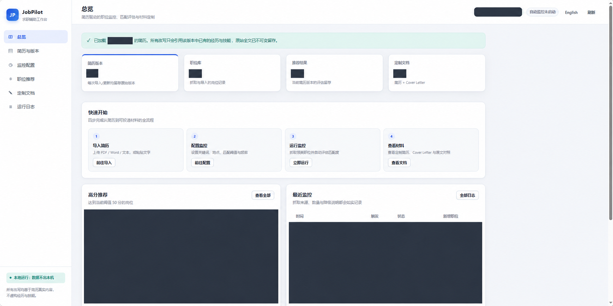
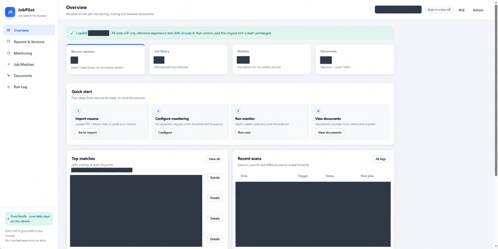
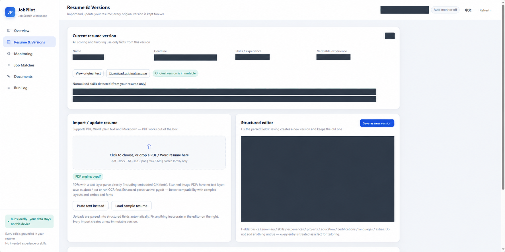
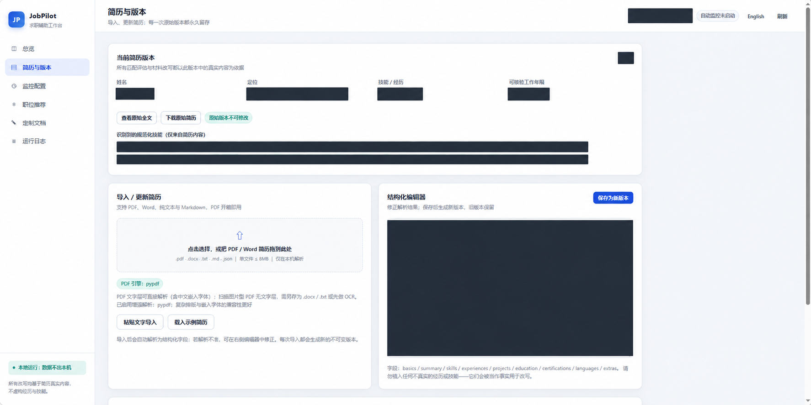
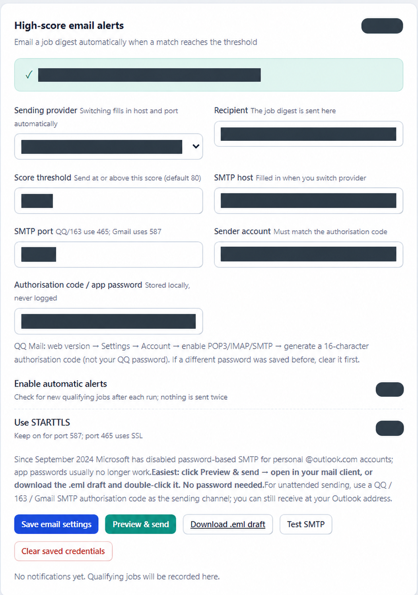
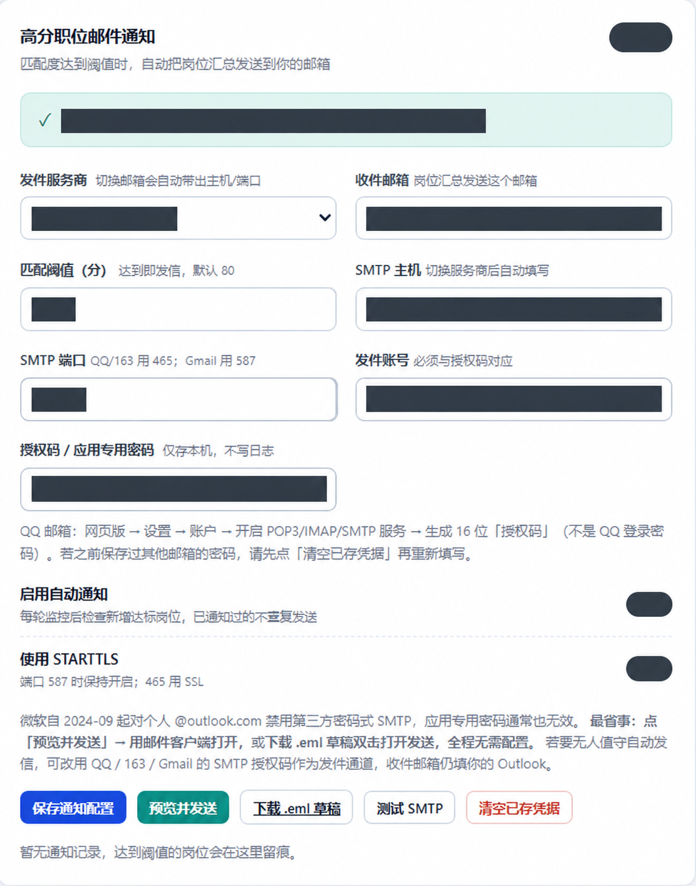
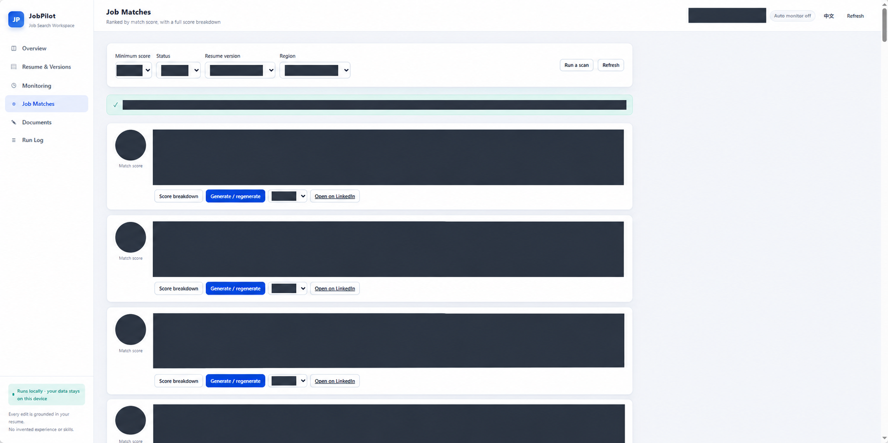
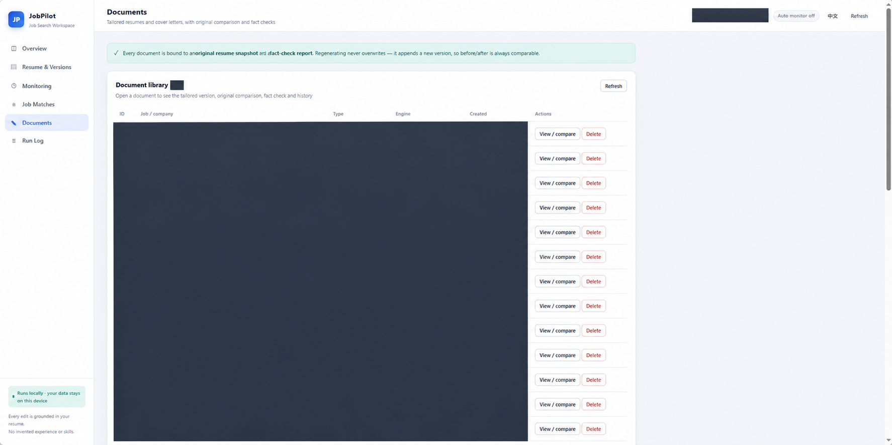

# JobPilot

**简体中文** · [English](README.en.md)

本地优先的求职工作台：导入简历、收集职位、查看可解释的匹配评分，并生成可以核对来源的定制简历与求职信。

Python 标准库后端 + SQLite + 原生 JavaScript。**基础功能无需安装第三方 Python 包，也不需要 API Key。** 可选接入 OpenAI 兼容接口进行 AI 润色。

> 这是面向个人使用的本地应用。匹配分是规则评分，不是录用概率；生成内容和 PDF 提取结果需要人工复核。程序不会自动提交求职申请。

## 功能

| 功能 | 当前实现 |
| --- | --- |
| 简历与版本 | 导入 PDF、DOCX、TXT、Markdown、JSON；编辑结构化信息；每次保存追加版本，保留提取的原文 |
| 职位来源 | 手动粘贴 JD / 导入 JSON；LinkedIn 公开职位抓取；明确标注的演示职位 |
| 匹配评估 | 技能、经验、职位方向、领域、教育、地点六个维度；显示命中与缺失技能、评分依据 |
| 定制材料 | 规则生成简历和求职信；可选 AI 润色；保留原文快照及规则检查报告 |
| 导出 | Markdown、TXT、DOCX；重新生成时追加文档版本 |
| 监控与通知 | 后台定时监控、运行日志、可选 SMTP 汇总通知、EML 草稿 |
| 双语界面 | 右上角切换中文 / English，浏览器记住偏好；文档语言单独配置 |

## 界面预览

以下 8 张图片已做隐私遮挡，并经本人确认用于展示。图片经过图像编辑，尺寸和部分文字可能与当前版本不同；数据流向以 [隐私说明](PRIVACY.md) 为准。



<details>
<summary>展开其余 7 张中英文预览</summary>

### 总览（英文）



### 简历与版本（英文）



### 简历与版本（中文）



### 邮件通知（英文）



### 邮件通知（中文）



### 岗位匹配（英文）



### 文档列表（英文）



</details>

## 快速开始

需要 **Python 3.9 或更高版本**。建议使用仍在维护的 Python 版本。正常使用无需 Node.js、数据库服务器或前端构建工具。

下载仓库 ZIP 并解压，在包含 `app/` 的项目目录打开终端。

**Windows**

```powershell
python -m app.server
```

也可双击 `start.bat`。

**macOS / Linux**

```bash
python3 -m app.server
# 或
bash start.sh
```

默认打开 [http://127.0.0.1:8765/](http://127.0.0.1:8765/)。关闭终端服务或按 `Ctrl+C` 即停止运行。

```bash
python -m app.server --no-browser
python -m app.server --port 9000
```

也可通过 `JOBPILOT_PORT` 环境变量修改端口。

### 三分钟体验

1. 打开「简历与版本」，点击「载入示例简历」。示例人物与经历均用于演示。
2. 在「监控配置」使用「载入演示职位」运行完整演示流程，无需 LinkedIn 或 AI 密钥。
3. 打开「职位推荐」，查看匹配分、技能差距与评分依据。
4. 打开「定制文档」，核对正文、原文快照与规则检查报告，下载 DOCX。
5. 正式使用时导入自己的简历，检查结构化字段，并修改关键词、地区和通知设置。

默认允许抓取失败时回退演示职位，界面会标明来源。**正式搜索建议关闭“演示数据降级”**，避免把演示结果当成真实招聘机会。邮件通知只有配置有效收件地址及 SMTP 凭据后才能发送。

## 中英文切换

- **README：** 点击本页顶部的 [English](README.en.md)；英文页顶部可切回中文。GitHub Markdown 使用双文档链接切换，无需脚本。
- **应用：** 点击右上角 `English` / `中文`，或访问 `/?lang=en`、`/?lang=zh`。
- **材料：** 文档语言可设为自动、中文、英文，与界面语言独立。规则引擎保留引用内容的原语言，不会把整份原始简历自动翻译。
- 原始简历、职位描述、部分后端日志和解释文字保留原语言；界面切换不等于全文翻译。

## AI、隐私与外部连接

默认使用本地规则引擎；启用 AI 后，**结构化简历（可能包含姓名和联系方式）、岗位描述及规则生成的草稿会发送到你配置的 API 服务商**。API Key 作为认证信息发送至该接口。只使用你信任的接口地址。

| 场景 | 数据流向 |
| --- | --- |
| 简历解析、规则匹配、规则生成、文档导出 | 本机处理与存储 |
| LinkedIn 抓取 | 向 LinkedIn 发送查询关键词与目标地区；通过配置的代理连接时也经过该代理 |
| 网络诊断 / 代理检测 | 可能进行本地代理探测和外部连通性请求 |
| AI 润色 / 连接测试 | 向配置的模型端点发送请求；润色请求包含简历和岗位内容 |
| SMTP 通知 | 向配置的邮件服务商认证，并发送岗位汇总至收件人 |
| 安装可选 PDF 增强 | 使用 pip 下载 `pypdf` |

本地数据写入 `data/jobpilot.db`。**数据库未加密**，可包含简历、联系方式、SMTP 凭据、API Key、岗位及历史文档。接口掩码不等于磁盘加密。

服务仅绑定 `127.0.0.1`，增加了 Host、Origin 和 JSON 请求检查；没有账号权限系统，不适合直接暴露到公网或作为多人服务。这些检查不防御已能访问本机的程序。

详见 [隐私说明 / Privacy notes](PRIVACY.md)。

## 匹配与生成机制

基础评分权重：技能 40、经验 15、职位方向 15、领域 15、教育 5、地点 10；另外结合地区偏好、排除公司等规则调整或排除。分数用来辅助排序，不能证明岗位真实、仍在招聘，也不能判断签证担保、工作许可或全部语言要求。

规则引擎按岗位相关性重排、分组和引用已有内容。AI 输出中的数字与已识别技能会与白名单比较，检查失败时回退规则生成。**检查不覆盖所有语义事实**：例如未识别的技能、职责夸大、实体关系错误仍可能漏检。“检查通过”不等于事实已被独立验证。

导入保存的是提取文本及结构化信息，**不保存原 PDF / DOCX 文件本身**。请另行保存源文件。历史版本由应用按追加方式维护，不代表底层数据库不可修改或具有防篡改能力。

## PDF 与文件兼容性

内置 PDF 提取器无需额外安装。也可安装增强库：

```bash
python -m pip install pypdf
```

已安装的增强解析器会优先使用；返回明显控制字符、缺失字形标记或失败时继续尝试其他解析器。此检查不能发现所有乱码或漏字。扫描图片 PDF 需要另外做 OCR；复杂分栏、表格和字体仍可能提取不完整，建议改用 DOCX / TXT 或粘贴文本。

## 数据备份

1. 停止 JobPilot 服务。
2. 备份整个 `data/` 目录，并妥善保护其中的个人数据和密钥。
3. 恢复时先停止服务，再放回备份目录。

`.gitignore` 排除运行数据、密钥文件、缓存和常见导出文件。它无法清除已经进入 Git 历史的敏感文件，请勿使用 `git add -f` 强制上传运行数据。

## 开发与验证

```bash
# 原有端到端自检：使用独立临时数据库
python selftest.py

# 仅标准库环境，验证零必需依赖
python -S selftest.py

# 本地请求边界、路径保护、PDF 回退回归测试
python -m unittest discover -s tests -v

# 前端语法与链接协议检查；仅开发检查需要 Node.js
node --check web/app.js
node --check web/i18n.js
node tests/test_frontend.cjs
```

测试不会发送真实通知或调用付费模型；自检中的代理检测可能探测本地代理。GitHub Actions 配置覆盖 Windows / Ubuntu 和 Python 3.9 / 3.13，并分别运行标准库及 `pypdf` 环境检查。工作流配置存在不代表远端 CI 已运行。

```text
app/                   Python 后端：解析、匹配、文档、监控、通知、HTTP API
web/                   原生前端和中英文字典
data/.gitkeep          运行数据目录占位符
tests/                 请求边界、PDF 回退、前端链接回归测试
.github/workflows/     自动化检查配置
selftest.py            端到端自检
README.en.md           English documentation
PRIVACY.md             数据流向与隐私边界
```

## 已知限制与后续方向

- LinkedIn 抓取不是官方合作 API，可能受到登录、限流、访问规则或页面结构变化影响；失败时可手动导入 JD。请遵守来源平台规则。
- 后台监控依赖 Python 进程持续运行；关闭程序、电脑休眠或断网会影响监控。
- SMTP 当前使用密码 / 授权码方式，不包含 OAuth 登录；是否可用取决于邮箱提供商及账户策略。
- 不保证识别所有签证、第二语言、截止日期或职位过期要求。正式申请前回到雇主招聘页面核对。
- UI 为原生单页应用；当前翻译层仍有部分动态文字未完全国际化。
- **GitHub Pages 只能托管静态文件，不能运行这个 Python 后端。** 上传 GitHub 是发布源码，不等于部署在线服务。

后续可以优先增加：雇主官网 / ATS 数据源、工作许可与语言条件筛选、岗位过期处理、结构化简历表单、可编辑文档及更完整的多语言消息。

## 许可与贡献

[MIT License](LICENSE)。提交问题或示例时请使用虚构数据，不要附上真实简历或密钥。
